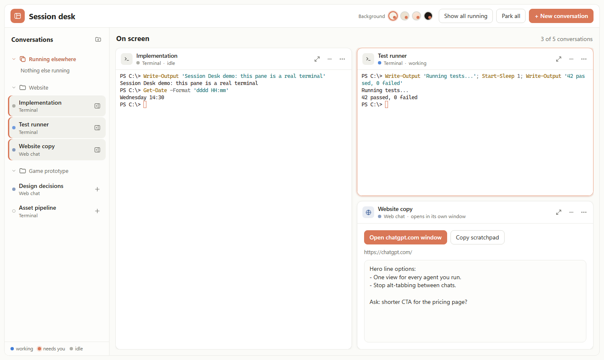
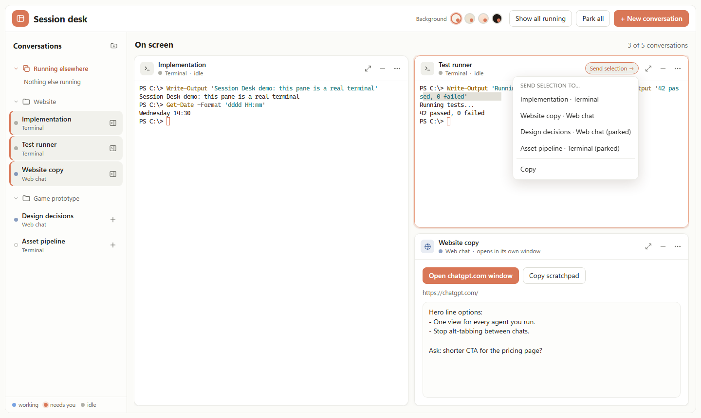
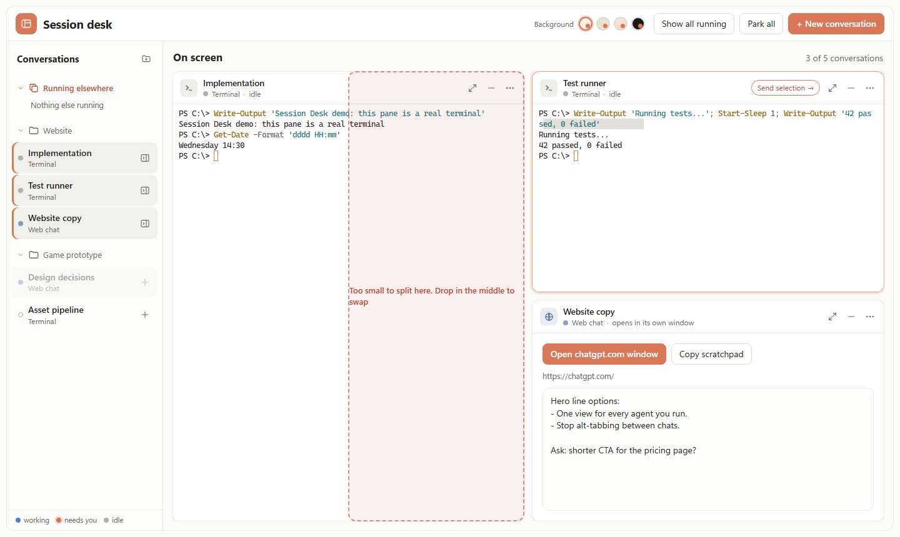
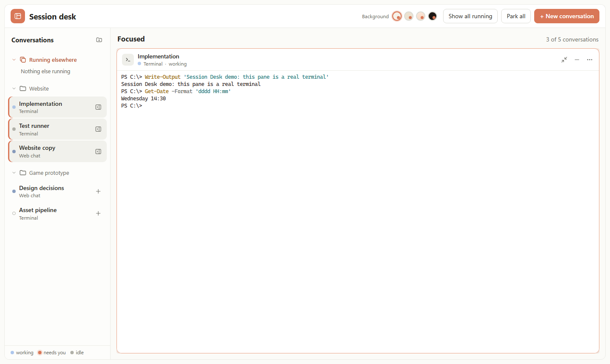
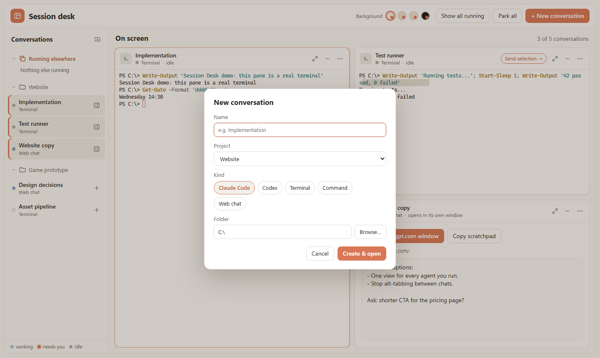
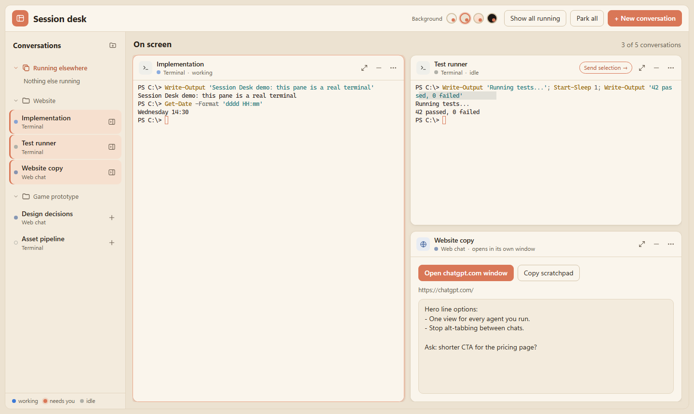
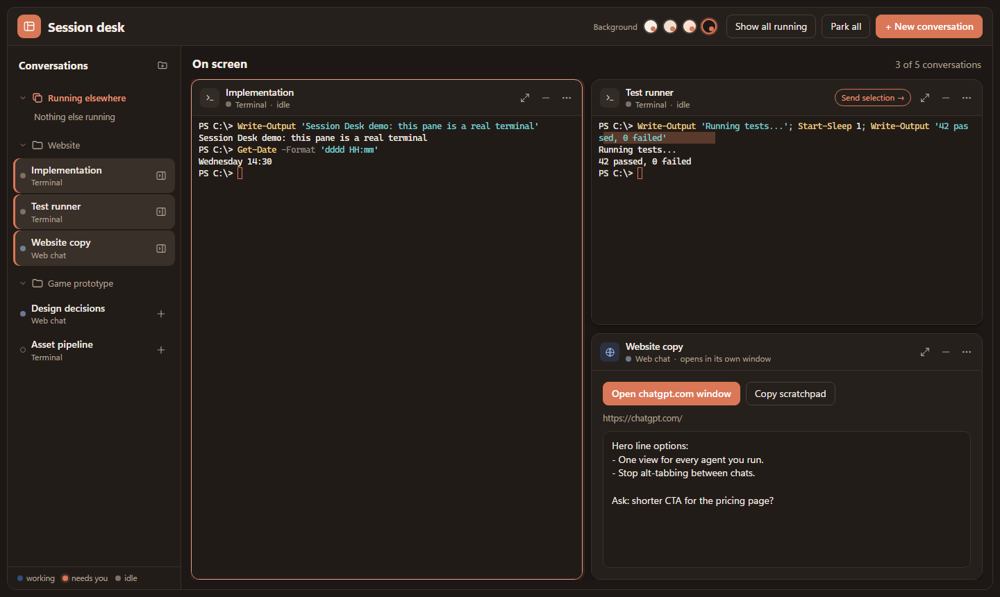

# Session Desk

One window for every AI agent and chat you have open: Claude Code, Codex, plain terminals, any CLI,
plus ChatGPT and Claude desktop/web chats. Arrange them side by side, expand one, park the rest, and
keep typing into each conversation on its own. You stay the filter between agents.



Windows only for now (it uses Windows APIs to find and arrange other apps' windows).

## Run it

Requirements: Windows 10/11, Node.js 18+, Microsoft Edge or Chrome.

```
start.cmd        # starts the desk and opens its window (the first run installs what it needs)
stop.cmd         # stops it (puts snapped windows back first)
autostart.cmd    # optional: start the desk when you sign in to Windows (run again to turn off)
```

Whatever was running when the desk stopped (or the PC restarted) starts again on its own: Claude Code
resumes the exact conversation, Codex its last one, terminals start fresh. Your layout is kept too, so
with `autostart.cmd` on, signing in brings everything back without a click.

The desk listens only on `127.0.0.1:47821` and needs a per-install token (created in `data/`, never
committed). Closing the desk window doesn't stop your sessions; `stop.cmd` does. Log: `data/desk.log`.

`DESK_DEMO=1 node server.js` runs it without looking at your real sessions (used for the screenshots).

## What it does

| | |
|---|---|
| **One-click start** | **+ Claude Code** starts one right away in the current project's folder, named for you. The arrow next to it has Codex and Terminal; *Other…* is for a custom command, a web chat or another folder. `Ctrl+Alt+N` does the same as the button. |
| **Arrange all** | Puts everything that's running on screen side by side: conversations in the desk and windows and sessions found elsewhere. |
| **Sidebar** | Conversations grouped by project folder, each with its kind and a status dot: working, needs you, idle. A "Running elsewhere" group finds sessions you started outside the desk. |
| **Arrange** | Drag a conversation onto a pane's edge to split, onto its middle to swap. Drag dividers to resize; double-click one to even them out. |
| **Expand / park** | Double-click a pane header to give it the whole stage, again to restore. `−` parks a pane: it disappears from the screen but keeps running. |
| **Real terminals** | Claude Code, Codex, shells and custom commands run in real terminals inside the desk. Claude Code can resume the exact conversation after a restart. |
| **Send selection** | Select text in one pane and drop it into another conversation as a draft. Nothing is sent until you press Enter. |
| **Outside sessions** | Claude Code sessions running in other terminals or IDEs show up automatically with live transcripts. ChatGPT, Claude and Codex desktop windows (and browser tabs on those sites) show up too. |
| **Snap** | An outside app's real window can be snapped over its pane. It stays its own normal window (typing works as usual, and the desk can never close it), and follows the desk as you move, resize or minimize it. If the app moves or resizes its window itself (ChatGPT does), or you drag it out, it goes back into its pane. |
| **Backgrounds** | Claude orange accents on four backgrounds: Milk (default), Sand, Peach and Ember (dark). |

| Send selection between agents | Drag to split (with size rules) |
|---|---|
|  |  |
| **Expanded pane** | **New conversation** |
|  |  |
| **Sand** | **Ember (dark)** |
|  |  |

## Layout rules (so nothing collapses)

- A pane is never smaller than **300 × 200**. Splits, divider drags and new panes all respect it.
- A drop on a pane's edge only splits when both halves stay usable. Otherwise the drop zone turns red
  and suggests swapping.
- Opening a conversation when the screen is full: it goes beside the others if there's room, otherwise
  it splits the biggest pane, otherwise it replaces the pane you used least recently. That one stays
  running, parked in the sidebar.
- If the window itself gets too small, the stage scrolls instead of squashing panes.

## How it's built

| File | Role |
|---|---|
| `server.js` | Local server: runs terminals in pseudo-terminals (node-pty), saves the layout, talks to the page over a WebSocket |
| `discovery.js` | Finds outside sessions: Claude Code's `~/.claude/sessions` registry plus transcripts, and chat app/browser windows |
| `winhelper.cs` | Small Windows helper (compiled on first run by the C# compiler that ships with Windows): lists windows, snaps them over panes, follows the desk via WinEvent hooks |
| `public/` | The desk UI: plain JS, xterm.js with the WebGL renderer |
| `mods/desk-themes` | A Claude Code mod with the same four backgrounds; `/desk-theme peach` switches (it shows in the Claude desktop and mobile apps) |

Measured on the development machine: desk server about 65 to 75 MB, window helper 27 MB at 0.4% of
one core. Claude Code sessions run directly, without a PowerShell wrapper (about 60 to 70 MB saved
each). Scanning drops to every 15 s while the desk is hidden.

## Where it stands

**Working and tested**
- Real terminal panes: typing, scrollback restored after a reload, layout saved across restarts
- Split, stack, swap, expand, park, and the layout rules above (automated browser tests)
- Discovery of outside Claude Code sessions, with live transcripts and titles; ChatGPT and Claude
  desktop windows
- Send selection between panes
- Four backgrounds, and the matching Claude Code mod (validated and type-checked)
- Snapping: a window lands exactly on its pane (checked to the pixel on a second monitor)

**Fixed**
- A conversation could be stopped when another desk window, holding an older copy of the list, saved
  its layout. Now only removing a conversation on purpose stops it.
- Starting a conversation that was already running restarted it. Now that only happens through
  *Restart* in its menu.
- On a fresh copy, the first start could fail because the log folder didn't exist yet.

**Changed along the way**
- Windows used to be *embedded* (reparented into the desk). That broke typing (Edge took the keyboard
  back) and could close apps when a desk window closed. Snapping replaced it.
- The window helper was a PowerShell script. It's now a compiled program because PowerShell buffered
  its input, which made it slow.

**Known limits**
- ChatGPT and claude.ai refuse to be shown inside other pages, so web chats open in their own window.
  Their pane keeps the link and a scratchpad, or you can snap the window in.
- You can't type into an outside Claude Code session from the desk itself. **Reply here** snaps its
  window into the pane and leaves it running where it is. **Move into desk** ends it there and resumes
  the same conversation inside the desk.
- A snapped window can't be minimized or maximized on its own; it goes back into its pane. Use the
  pane's park button, or **Unsnap**.
- The "needs you" status is a heuristic for in-desk terminals. It's exact for outside Claude Code
  sessions, which report it themselves.
- Windows only.

**Next up**
- One-click "Claude Code (remote control)" conversation kind
- Hands-on testing of snapping across more apps and multi-monitor setups with different scaling

## License

MIT, see [LICENSE](LICENSE). `mods/desk-themes/hooks/make-colors.*` is a helper copied from Claude Code's
mod-authoring kit (mods are meant to ship a copy of it) and isn't covered by this license.
